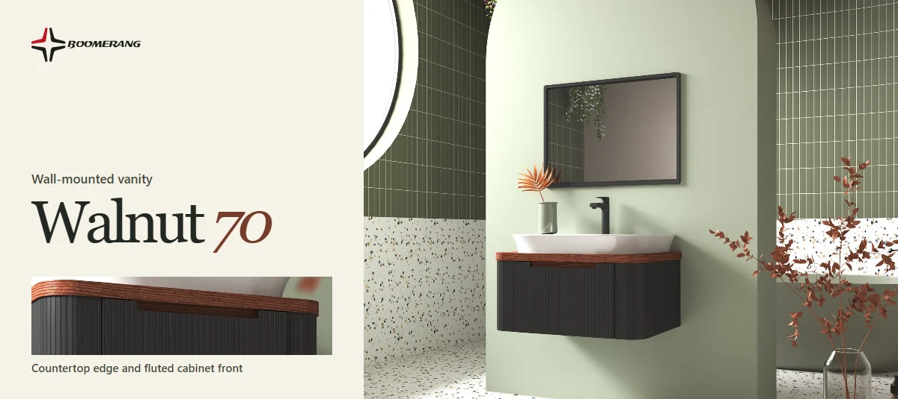
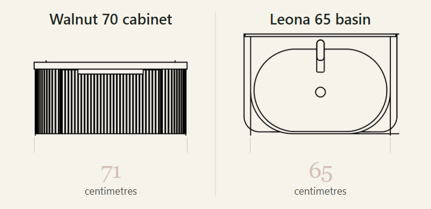

[معرفی فارسی](README.md)

# Boomerang bathroom catalogue

Browse vanity sets, basins, mirrors and faucets by model. Each product page brings its photographs and specifications together. If a model suits your project, leave an email address or phone number on that page to ask for a quote.

[English catalogue](https://www.boomerang-co.com/en/) · [فارسی](https://www.boomerang-co.com/fa/) · [العربية](https://www.boomerang-co.com/ar/) · [Русский](https://www.boomerang-co.com/ru/)

<a href="https://www.boomerang-co.com/en/products/walnut-70/">
  <picture>
    <source media="(max-width: 650px)" srcset="docs/readme/walnut-en-mobile.webp">
    
  </picture>
</a>

## How wide is the Walnut 70 cabinet?

The 70 in Walnut 70 is part of the model name. If you’re marking out the cabinet on a wall, it measures **71 cm** across. The **65 cm** measurement on the drawing belongs to the Leona basin that sits on top. The two views below use the same scale.

<picture>
  <source media="(prefers-reduced-motion: reduce)" srcset="docs/readme/walnut-dimensions-en.webp">
  
</picture>

[Walnut 70 component dimensions](https://www.boomerang-co.com/en/products/walnut-70/#components) · [Enquire about this model](https://www.boomerang-co.com/en/products/walnut-70/#inquiry) · [All vanity sets](https://www.boomerang-co.com/en/categories/vanity-sets/)

Each language has its own set of HTML pages. [Published site files](production/current/public_html/)
