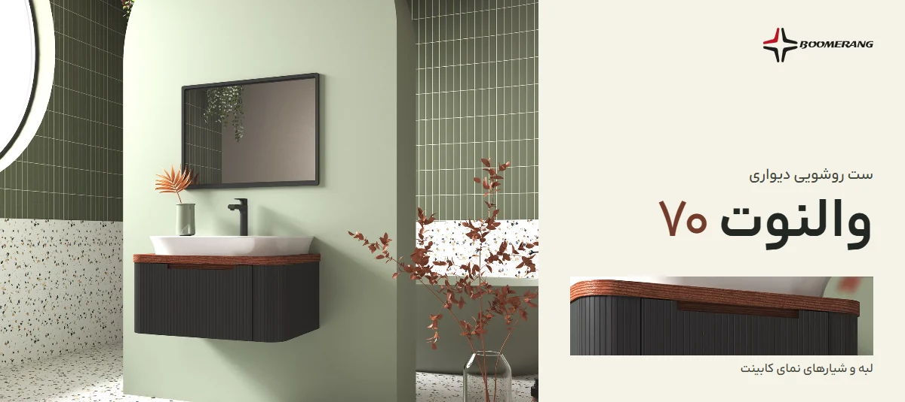
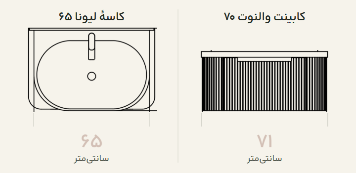

<a href="README.en.md" lang="en">English README</a>

# کاتالوگ بین‌المللی بومرنگ

در کاتالوگ بومرنگ می‌توانی ست روشویی، کاسه، آینه و شیرآلات را بر اساس مدل پیدا کنی. عکس‌ها و مشخصات هر مدل کنار هم‌اند. اگر مدلی را برای پروژه‌ات انتخاب کردی، در همان صفحه برای استعلام ایمیل یا شمارهٔ تماست را می‌گذاری.

[کاتالوگ فارسی](https://www.boomerang-co.com/fa/) · [English](https://www.boomerang-co.com/en/) · [العربية](https://www.boomerang-co.com/ar/) · [Русский](https://www.boomerang-co.com/ru/)

<a href="https://www.boomerang-co.com/fa/products/walnut-70/">
  <picture>
    <source media="(max-width: 650px)" srcset="docs/readme/walnut-fa-mobile.webp">
    
  </picture>
</a>

## طول کابینت والنوت ۷۰ چقدر است؟

«۷۰» بخشی از نام مدل است. اگر می‌خواهی طول کابینت را روی دیوار علامت بزنی، اندازهٔ آن **۷۱ سانتی‌متر** است. عدد **۶۵ سانتی‌متر** در نقشه به کاسهٔ لیونا مربوط می‌شود که روی کابینت می‌نشیند. هر دو قطعه را اینجا با یک مقیاس می‌بینی.

<picture>
  <source media="(prefers-reduced-motion: reduce)" srcset="docs/readme/walnut-dimensions-fa.webp">
  
</picture>

[جدول اجزای والنوت ۷۰](https://www.boomerang-co.com/fa/products/walnut-70/#components) · [استعلام همین مدل](https://www.boomerang-co.com/fa/products/walnut-70/#inquiry) · [بقیهٔ ست‌های روشویی](https://www.boomerang-co.com/fa/categories/vanity-sets/)

هر چهار زبان صفحه‌های HTML جداگانه دارند. [فایل‌های نسخهٔ منتشرشده](production/current/public_html/)

